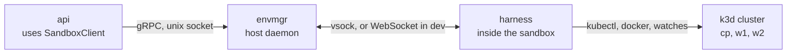

# sandbox

> **Everything that runs a sandbox:** the `envmgr` host daemon, the in-VM `harness`, the `SandboxClient` library that `api` uses, and the VM and lesson images.

Part of [**kubernetes-learning-platform**](https://github.com/kubernetes-learning-platform/docs), an AI tutor with a live Kubernetes lab. Start at the [docs hub](https://github.com/kubernetes-learning-platform/docs) for the big picture.

**Owner:** Filip · **Status:** planned layout, scaffolding lands in M1.

---

## 🧭 How it fits



Every session gets its own disposable sandbox: a microVM running a 3-node k3d cluster. `api` never talks to the VM directly. It asks `envmgr` for a sandbox, and `envmgr` relays frames to and from the `harness` inside it. Secrets and the LLM key never enter the VM.

## 🧩 Projects

| Project | What it is | Ships as |
|---|---|---|
| `KubernetesLearning.EnvManager` | Host daemon under systemd. VM lifecycle, warm pool, TTL reaper, re-adoption after a restart, harness relay | Binary → GitHub Releases |
| `KubernetesLearning.Harness` | Native AOT program inside every sandbox. Exec, PTY, files, faults, Kubernetes and Docker watchers, topology, traffic probe | Binary → GitHub Releases, baked into the VM image |
| `KubernetesLearning.SandboxClient` | The .NET client `api` uses: `ISandboxSession`, plus `FakeSandboxSession`, a scripted cluster for `api` tests and `web` development | NuGet → GitHub Packages |
| `KubernetesLearning.Sbx` | Dev CLI: `sbx create \| exec \| watch \| destroy` | Not shipped |

## 🔌 envmgr's gRPC service

One service, `EnvironmentManager`, on `/run/kubernetes-learning/envmgr.sock`:

| Method | Purpose |
|---|---|
| `CreateSandbox` | Takes a VM from the warm pool (or boots one). Returns the sandbox id and status. |
| `DestroySandbox` | Tears down the VM, its systemd unit, taps and state. |
| `GetSandbox` / `ListSandboxes` | Status. `ListSandboxes` is for debugging and the demo. |
| `WatchSandbox` | Status stream: `booting → cluster_ready → failed / destroyed`. |
| `Connect` | Bidirectional `HarnessFrame` stream that `envmgr` pipes to the harness. |

## 🛡️ Harness

One connection, one frame router:

- **Handlers:** `Exec`, `Pty`, `File`, `Fault`.
- **Fault ledger:** records every fault (`kill_node`, `delete_pod`, `partition`, `bad_image`) with its undo action, so it can be reverted and the UI can mark it.
- **Watchers:** Kubernetes (nodes, pods, deployments, replicasets, services, endpoints, events) and Docker events for the node containers.
- **Topology:** a normalized graph. A snapshot on connect, then revisioned diffs.
- **Traffic probe:** a probe pod curls a lesson service, and the harness turns its logs into `TrafficSample` messages about once a second.

## 🖥️ Providers

| Provider | Where | How |
|---|---|---|
| `VmmProvider` | Demo host (Linux + KVM) | One microVM per session (Firecracker or Cloud Hypervisor, **OPEN**), each in its own systemd unit `kl-vm-<id>`. The harness dials vsock `CID 2 : 5000`. |
| `DockerProvider` | macOS / Windows dev machines | A privileged Docker-in-Docker container running k3d. The harness dials a WebSocket with a one-time token. |

## 📁 Layout

```
sandbox/
├── src/
│   ├── KubernetesLearning.EnvManager/     # Grpc/, Relay/, Providers/, Lifecycle/, Host/
│   ├── KubernetesLearning.Harness/        # Transport/, Handlers/, Faults/, Watch/, Topology/, Traffic/, Native/
│   ├── KubernetesLearning.SandboxClient/  # ISandboxSession, SandboxSession, Fakes/
│   └── KubernetesLearning.Sbx/            # dev CLI
├── tests/
│   ├── EnvManager.Tests/
│   ├── Harness.Tests/
│   └── Integration.Tests/                 # Docker provider + real harness + SandboxClient
├── images/
│   ├── base/                              # VM base image (mkosi or Packer, OPEN)
│   └── lessons/
│       ├── demo-web/                      # v1, v2; replies with its pod name
│       └── traffic-probe/                 # tiny curl loop used by the traffic probe
├── Directory.Build.props
└── .github/workflows/                     # ci.yml, release.yml → platform workflows
```

## 🛠️ Local development

No KVM needed. Run `envmgr` with `dotnet run` and `Provider=Docker`. The harness (a linux-arm64 build on Apple Silicon) runs inside a privileged DinD container and dials `envmgr` over WebSocket.

- Give Docker Desktop **at least 6 GB** of memory. One sandbox takes 3–4 GB, so a 16 GB Mac fits one at a time.
- envmgr settings are env vars only: `Provider=Vmm|Docker`, `WarmPool__Size`, `StateDir`, `BaseImage__Path`, `Sandbox__MaxLifetime`.

## 🚀 Releases

A tag publishes:
- `envmgr` and `harness` binaries for **linux-x64 and linux-arm64** → GitHub Releases
- `KubernetesLearning.SandboxClient` → GitHub Packages
- a new VM base image (x64) with the matching harness baked in, via `platform`'s `vm-image.yml`
- the lesson images (`demo-web`, `traffic-probe`), multi-arch → GHCR

Nothing is downloaded at runtime: every image the cluster needs is baked into the VM image.

## ⚠️ Read before M1

The [technical risks](https://github.com/kubernetes-learning-platform/docs/blob/main/ARCHITECTURE.md#10-technical-risks-read-before-m1) all land in this repo:
- `KubernetesClient.Aot` has **no watch support**, so the harness watches through `kubectl get -w` subprocesses.
- .NET has no PTY API. Use `openpty` through P/Invoke, and **never call `fork()`** from .NET.
- .NET has no `AddressFamily.Vsock`. Use `(AddressFamily)40` with a custom `EndPoint`.

## 📚 More

- [ARCHITECTURE §4 Services](https://github.com/kubernetes-learning-platform/docs/blob/main/ARCHITECTURE.md#4-services-and-their-entry-points) (envmgr and harness internals)
- [ARCHITECTURE §6 Key flows](https://github.com/kubernetes-learning-platform/docs/blob/main/ARCHITECTURE.md#6-key-flows)
- [PROJECT-BRIEF](https://github.com/kubernetes-learning-platform/docs/blob/main/PROJECT-BRIEF.md): the original sandbox design

## 📄 License

[MIT](LICENSE)
